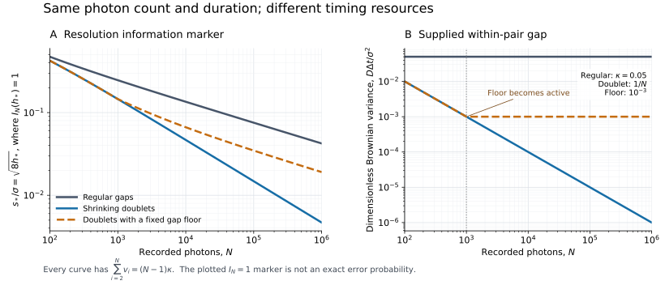

# Quantum Imaging Timing

**When an unresolved source pair moves, how much does the timing of the photons matter?** For a known Gaussian point-spread function and a Brownian common centroid, the full quantum resolution limit depends on the individual gaps between photons. Measurements on disjoint adjacent pairs attain its resolution order, even when arbitrary collective processing of the whole record is allowed.

**Sister project: [Quantum-Imaging-Calibration](https://github.com/GoGoKo699/Quantum-Imaging-Calibration).** Timing supplies the correlated Brownian record and known schedule; Calibration supplies the independent unknown-jitter experiment and charged point-source calibration. Their [joint frontier](science/joint-model.md) determines how both noises and a finite calibration budget act together. This repository owns the shared schedule-dependent theorem and proof; the sister account retains the independent-jitter result and its consequences. Learning a jitter variance leaves each signal photon's physical displacement intact.

The experiment supplies $`N`$ separately addressable one-photon spatial registers at known times. The two sources are equally bright and mutually incoherent, their separation $`s`$ is fixed, and their source labels are independent. The initial centroid is arbitrary and unknown; the diffusion coefficient $`D`$ and Gaussian intensity variance $`\sigma^2`$ are known. This is an explicit photon-register model with [physical access requirements](science/physical-interface.md).

## The timing law without independent jitter

Write

```math
q=\frac{s^2}{8\sigma^2},\qquad
v_i=\frac{D(t_i-t_{i-1})}{\sigma^2},\qquad
\mathcal I_N(q;\mathbf v)=\sum_{i=2}^{N}\frac{q^2}{q+v_i}.
```

For known deterministic schedules with $`0\lt v_i\le V`$, fixed $`V`$, and a design threshold $`0\lt h\le q_0`$, the fixed-error minimax boundary for distinguishing one source from two is

```math
\mathcal I_N(h;\mathbf v)=\Theta(1).
```

Here the null hypothesis is $`q=0`$ and the alternative is $`q\ge h`$, uniformly over the unknown centroid. The constants depend on the error target and fixed bounds, not on the photon count or individual schedule. This functional is an operational testing scale, not a Fisher-information formula.

The [collective converse](science/collective-converse.md) bounds distinguishability of the entire correlated quantum state. The [attaining receiver](science/receiver.md) chooses one of the two adjacent-pair matchings and measures each pair's SWAP symmetry. Translation invariance removes the absolute centroid, and independent internal Brownian increments make the selected outcomes independent.

## Joint jitter and calibration frontier

Add fresh independent Gaussian displacement of unknown dimensionless variance $`0\le w\le b`$ to every signal photon. Supply $`M`$ photons from a stabilized known-position point source with the same variance and independent realizations, with no access to the Brownian path. For known bounded positive gaps, define

```math
\sum_{i=2}^{N}\frac{r_0^2}{b+v_i+r_0}=1,
\qquad S_2=\sum_{i=2}^{N}(b+v_i)^{-2}.
```

The matching fixed-error quantum resolution order on a fixed local separation range is

```math
R_Q=r_0+\min\left\{b,\sqrt{\frac bM},S_2^{-1/4}\right\}.
```

Omit the calibration branch when $`M=0`$; at $`b=0`$ the minimum is zero. The root $`r_0`$ is the physical timing/jitter floor, while the minimum selects a bound, calibration or shape-sensitive test. [The precise theorem](science/joint-model.md#3-joint-frontier) gives the nuisance class, quantifiers and nonempty-alternative condition. The general attaining receiver uses a genuine joint relative-coordinate measurement and full HG mode-index detection; [four outcomes suffice for controlled close doublets](science/joint-receiver.md#5-four-outcome-close-doublet-receiver).

For close doublets of internal Brownian variance $`O(N^{-1})`$, write $`K=NM/(N+M)`$ and $`L=\max\{\sqrt N,K\}`$. Then

```math
R_Q\asymp N^{-1}+\min\{b,\sqrt{b/L}\}.
```

Calibration beats shape information around $`K\sim\sqrt N`$, but leaving a $`q\asymp b`$ uncertainty plateau requires $`Kb\gg1`$. Even unlimited calibration leaves $`q_*\asymp N^{-1}+\sqrt{b/N}`$ in minimax order. Fixed positive physical jitter therefore retains the $`N^{-1/4}`$ physical-separation exponent; the zero-jitter doublet law needs jitter itself to shrink to $`O(N^{-1})`$. [Crossover regimes](science/jitter-calibration-regimes.md) derive the distinctions and give a complete example.

## Consequences without independent jitter

The following table concerns the original Brownian-only experiment, with no independent per-photon jitter. Its separation scales suppress fixed physical constants. Each comparison uses the resource convention stated in its first column; the joint jitter/calibration law above has different crossovers.

| Acquisition regime | Quantum separation scale |
|---|---|
| Periodic arrivals, fixed positive motion per gap; duration grows with $`N`$ | $`s_*/\sigma=\Theta(N^{-1/4})`$ |
| Close doublets with internal motion $`O(N^{-1})`$, at the same count and duration as the periodic schedule above | $`s_*/\sigma=\Theta(N^{-1/2})`$ |
| Periodic arrivals, fixed total duration and increasing photon count | $`s_*/\sigma=\Theta(N^{-1/2})`$ |
| Ideal Poisson arrivals, fixed positive mean motion per gap and fixed photon-count stopping | $`s_*/\sigma=\Theta((N\log N)^{-1/4})`$ |

The close-doublet comparison changes the supplied acquisition schedule. It requires shrinking within-pair intervals and the corresponding timing and temporal-mode resources. For schedules with a fixed upper bound on their gaps, a fixed positive minimum gap restores the slower asymptotic exponent. The Poisson logarithm assumes that arbitrarily close arrivals remain independently addressable; it is not a claim about an unspecified finite-bandwidth optical field.



The figure solves $`\mathcal I_N(q)=1`$ to illustrate the scaling. It does not give exact fixed-error constants. See [timing regimes](science/timing-regimes.md) and the [Poisson experiment](science/poisson-arrivals.md) for the complete statements.

For **direct imaging in that Brownian-only experiment**, even optimal processing of all detected positions and timestamps has $`q_*=\Theta(N^{-1/2})`$, hence $`s_*/\sigma=\Theta(N^{-1/4})`$, throughout the bounded-gap setting. The [direct-imaging proof](science/direct-imaging.md) includes both a lower bound for every classical processing rule and an attaining pair-difference statistic. With unknown independent jitter, the [joint direct-imaging theorem](science/joint-model.md#4-direct-imaging) includes its calibration-dependent uncertainty term.

## Read the science

Start with the [scientific reading route](science/README.md), or go directly to the precise question you want to inspect.

| Question | Authoritative account |
|---|---|
| What exactly is supplied, and what is the testing task? | [Model and theorem](science/model-and-theorem.md) |
| How do Brownian motion, unknown independent jitter and finite calibration combine? | [Joint model and frontier](science/joint-model.md) |
| Why does the joint limit hold against every collective receiver? | [Covariance extraction and compensated converse](science/joint-converse.md) |
| How do relative modes retain shape and calibration information? | [Weighted joint receiver](science/joint-receiver.md) |
| When does calibration improve the order, and what floor remains? | [Jitter/calibration regimes](science/jitter-calibration-regimes.md) |
| Why can no collective quantum receiver do better in order? | [Collective converse](science/collective-converse.md) |
| How do photon pairs attain the boundary? | [Pair receiver](science/receiver.md) |
| How do count, duration, peak timing and timing floors differ? | [Timing regimes](science/timing-regimes.md) |
| Where does the Poisson logarithm come from? | [Poisson arrivals](science/poisson-arrivals.md) |
| What can positions and timestamps alone achieve? | [Direct imaging](science/direct-imaging.md) |
| What optical access does the register model require? | [Physical interface](science/physical-interface.md) |
| Which ingredients are inherited? | [Related work](references/related-work.md) and [bibliography](references/references.bib) |

The Brownian crossover exponents, static two-photon interference receivers and HG moment methods have prior precedents. The contribution developed here is the schedule-dependent characterization for the correlated record, its all-collective converse and adjacent-pair sufficiency, together with the joint unknown-jitter/calibration frontier obtained through covariance extraction and weighted relative moments. The related-work account gives the source-level comparison and its limits.

## Learn the project

The learning route starts from Mankei Tsang’s *Resolving starlight: a quantum perspective*. The [source-to-project bridge](learning/TSANG_BRIDGE.md) identifies the relevant sections, translates notation and assumptions, and works through a photon-pair example before introducing the additional tools needed for correlated motion.

The [30-milestone map](learning/MILESTONES.md) develops the project in two connected phases: 12 background milestones followed by 18 milestones through the timing receiver and converse, relative HG moments, joint calibration frontier and physical consequences. Use the [learning guide](learning/README.md) to choose an entry point and connect each milestone to the authoritative scientific account.

## Reproduce the checks

From the repository root:

```bash
python -m pip install -r verification/requirements.txt
python verification/run_all.py
```

The [verification guide](verification/README.md) explains the numerical tolerances, committed results, figure generation and the limits of finite checks. The analytic theorems rely on the written proofs; the checks examine fidelity conventions, the Brownian precision bound, exact pair probabilities, classical moments, the schedule examples, covariance extraction and weighted joint-receiver identities.

## Scope

The theorem assumes a known real Gaussian amplitude response, known diffusion, equal brightness, a fixed known separation axis and independent source labels. Receiver ancillas may be arbitrary but cannot reveal the hidden source labels or Brownian path. Count and timing statistics carry no additional separation information. The results concern fixed-error one-versus-two testing, not a global estimation-risk theorem. Temporal overlap, mode matching, loss and occupancy must be accounted for when connecting an optical source to the stated register interface.

The joint theorem additionally assumes fresh Gaussian jitter in a supplied bounded variance class and an independent stabilized calibration source with matching variance. It uses a local alternative $`h\le q\le q_0\le1/4`$ and bounded known positive Brownian gaps. Full HG relative-mode access in the general receiver is a stronger apparatus assumption than spatial SWAP parity alone. Calibration mismatch, unknown diffusion, trajectory-monitor references and non-Gaussian jitter require different analyses.

## Purpose and contact

This repository serves as a record of the work and a guide for the author’s self-directed learning. For discussion or potential collaboration, please contact Ruge Lin at [gogoko699@gmail.com](mailto:gogoko699@gmail.com).
