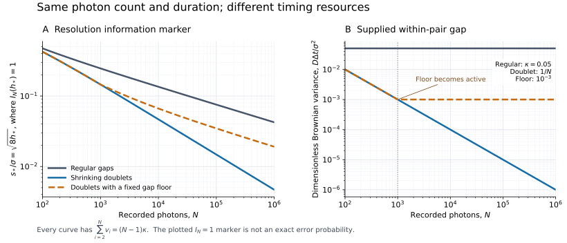

# What the acquisition schedule changes

For known diffusion and the timestamped spatial-copy model, the [main theorem](model-and-theorem.md) identifies the fixed-error information scale

```math
I_N(h;v)=\sum_{i=2}^{N}\frac{h^2}{v_i+h},\qquad
v_i=\frac{D\Delta t_i}{\sigma^2},\qquad
q=\frac{s^2}{8\sigma^2},\qquad s_h=\sqrt{8h}\,\sigma.
```

For $`0<v_i\le V`$ and design thresholds $`0<h\le q_0`$, small $`I_N`$ prevents reliable testing even with an arbitrary collective receiver, whereas sufficiently large $`I_N`$ is attained by the [pair receiver](receiver.md). All fixed-error constants depend on the prescribed error and the fixed model bounds. Solving $`I_N(h;v)=1`$ below provides a convenient **information-scale marker**, not an exact error-calibrated resolution.

The acquisition times are a resource in this statement. The most consequential comparison uses the same photon count and the same total duration at each $`N`$: regular arrivals can have separation order $`N^{-1/4}`$, while controlled close doublets have order $`N^{-1/2}`$. The doublets pay for that improvement through shrinking internal gaps. Holding the total duration fixed as $`N`$ grows gives a different conclusion.

## 1. Regular sampling: diffusion competes with the next photon

Let $`n=N-1`$, and suppose all physical gaps are $`\delta_N`$, giving a dimensionless variance increment $`v_N=D\delta_N/\sigma^2`$. Then

```math
I_N(h)=n\frac{h^2}{v_N+h}.
```

The marker $`I_N(h_*)=1`$ has the exact solution

```math
h_* =\frac{1+\sqrt{1+4nv_N}}{2n}
 =\Theta\left(\frac1N+\sqrt{\frac{v_N}{N}}\right).
```

Converting back to physical separation gives the fixed-error order

```math
\boxed{\displaystyle
\frac{s_{\rm res}}\sigma
 =\Theta\left(N^{-1/2}+\left(\frac{v_N}{N}\right)^{1/4}\right).}
```

The regimes are:

| Sampling regime | Motion increment | Separation order |
| --- | --- | --- |
| Fixed positive gap | $`v_N=v>0`$ | $`N^{-1/4}`$ |
| Crossover | $`v_N=\Theta(N^{-1})`$ | $`N^{-1/2}`$, with a motion-dependent constant |
| Faster regular sampling | $`v_N=o(N^{-1})`$ | $`N^{-1/2}`$ |

Within the regular family, attaining the static separation order requires $`v_N=O(N^{-1})`$. In physical units this means

```math
\delta_N=O\left(\frac{\sigma^2}{DN}\right),\qquad
\lambda_N:=\frac1{\delta_N}
 =\Omega\left(\frac{DN}{\sigma^2}\right).
```

The conclusion concerns a full correlated quantum record, including arbitrary attempts to infer and compensate the trajectory. It follows from a state-distance bound, not from the performance of a particular tracking method.

Brownian degradation of separation sensitivity and the $`N^{-1/4}`$ versus $`N^{-1/2}`$ distinction already appear in [Schlichtholz's dynamic-SPADE analysis](https://arxiv.org/abs/2407.13723). The result here is the optimal full-record testing scale for a supplied schedule and its attainment without centroid realignment; see the [related-work comparison](../references/related-work.md).

## 2. Equal photon count and duration at fixed mean rate

Fix $`\kappa>0`$ and an even photon count $`N=2M\ge4`$. Compare two schedules with the identical dimensionless duration

```math
B_N:=\sum_{i=2}^{N}v_i=(N-1)\kappa,
```

equivalently the same physical duration

```math
T_N=\frac{\sigma^2}{D}(N-1)\kappa.
```

Both schedules have mean interval $`\kappa\sigma^2/D`$, so their average rate remains fixed while $`T_N`$ grows proportionally to $`N`$.

### Regular schedule

Every gap is $`v_i=\kappa`$. The previous calculation gives

```math
h_{\rm res}^{\rm reg}=\Theta(N^{-1/2}),\qquad
s_{\rm res}^{\rm reg}/\sigma=\Theta(N^{-1/4}).
```

### Doublet schedule

Fix $`b>0`$. For sufficiently large even $`N`$ so that $`b/N\le\kappa`$, put the photons into $`M`$ doublets. Their $`M`$ internal gaps have variance

```math
u_N=\frac bN.
```

There are $`M-1`$ between-doublet gaps. Choose their common variance to be

```math
w_N=\frac{(N-1)\kappa-Mu_N}{M-1}.
```

This gives exactly $`M u_N+(M-1)w_N=B_N`$. Moreover,

```math
\kappa\le w_N\le3\kappa,\qquad w_N\longrightarrow2\kappa,
```

so the whole family satisfies a fixed maximum-gap bound. No photon is discarded in this comparison. The schedule information is

```math
I_N^{\rm dbl}(h)
 =M\frac{h^2}{u_N+h}+(M-1)\frac{h^2}{w_N+h}.
```

At $`h=a/N`$ with fixed $`a>0`$, the internal-pair contribution is exactly

```math
M\frac{(a/N)^2}{(b+a)/N}=\frac{a^2}{2(a+b)},
```

while the remaining contribution tends to zero. Choosing a sufficiently large constant $`a`$ supplies any prescribed fixed information budget. Conversely, every schedule obeys $`I_N(h)\le(N-1)h`$, so the collective converse excludes a better order. Consequently,

```math
\boxed{\displaystyle
h_{\rm res}^{\rm dbl}=\Theta(N^{-1}),\qquad
s_{\rm res}^{\rm dbl}/\sigma=\Theta(N^{-1/2}).}
```

This comparison uses identical $`N`$ and $`T_N`$ at every sample size. It shows that neither photon count nor mean rate determines the resolution by itself. A substantial fraction of photons in close pairs is enough; the centroid may diffuse considerably between doublets.

The resource difference is explicit: each doublet's physical internal gap is

```math
\delta_N^{\rm short}=\frac{b\sigma^2}{DN},
```

which shrinks with $`N`$ even though the average rate stays fixed. The theorem does not provide source timing control, free storage, or extra photons. These are two different supplied acquisition schedules, not two receivers applied to the same arrival stream. The rate requirement derived for regular sampling is therefore not a universal lower bound on average rate.

## 3. A fixed total duration changes the comparison

Now hold the physical interval $`T`$ fixed while increasing the number of recorded photons. Put $`B=DT/\sigma^2`$. The regular schedule has $`v_i=B/n`$, so its information marker is exactly

```math
h_*^{\rm reg}=\frac{1+\sqrt{1+4B}}{2n}.
```

It already has separation order $`N^{-1/2}`$.

More generally, every positive-gap schedule with this same fixed duration satisfies

```math
\frac{n^2h^2}{B+nh}
 \le I_N(h;v)\le nh.
```

The lower bound is Jensen's inequality, or Cauchy–Schwarz, applied to $`\sum_i(v_i+h)^{-1}`$. Equality on the left occurs for the regular schedule. At $`h=a/n`$, the bounds become $`a^2/(B+a)\le I_N\le a`$. Thus every such schedule has the same $`N^{-1/2}`$ separation **order** when $`B`$ is fixed; timing changes constants rather than this exponent. The fixed-error theorem applies with $`V=B`$.

The regular/doublet exponent contrast in the preceding section therefore requires the stated family $`T_N\propto N`$. “Same duration” means the two schedules share a duration at each $`N`$; it does not mean that this common duration remains fixed throughout that family.

## 4. Positive gap floors and the end of the doublet regime

Suppose the supplied schedule must satisfy fixed positive bounds

```math
0<v_{\min}\le v_i\le V<\infty.
```

Then

```math
n\frac{h^2}{V+h}\le I_N(h;v)
 \le n\frac{h^2}{v_{\min}+h}.
```

For large $`N`$, these force $`h_{\rm res}=\Theta(N^{-1/2})`$ and $`s_{\rm res}/\sigma=\Theta(N^{-1/4})`$, uniformly over that bounded-gap class. A smaller fixed floor improves constants, but cannot sustain the static exponent asymptotically.

For the doublet family, imposing the floor by setting

```math
u_N=\max\{b/N,v_{\min}\},\qquad 0<v_{\min}<\kappa,
```

and choosing $`w_N`$ from the same exact-duration equation preserves the comparison. The shrinking-gap regime ends near $`N=b/v_{\min}`$. Beyond it the internal gaps are fixed, and the asymptotic separation order returns to $`N^{-1/4}`$.

In physical units a minimum spacing $`\delta_{\min}>0`$ gives $`v_{\min}=D\delta_{\min}/\sigma^2`$. If the total duration is also fixed, the constraints allow only $`N-1\le T/\delta_{\min}`$ intervals; an unlimited-$`N`$ asymptotic sequence is then infeasible.

A minimum actual spacing, detector dead time, discarded detections, finite temporal-mode width, and rounded timestamps are different experimental changes. This calculation concerns a floor on the **actual supplied intervals**. It does not identify those other changes with this floor; see [physical-interface.md](physical-interface.md).

## 5. Relation to ideal Poisson sampling and direct imaging

For fixed-count exponential gaps with mean dimensionless increment $`\kappa=D/(\lambda\sigma^2)`$, the separate [Poisson theorem](poisson-arrivals.md) gives

```math
\mathcal I_N(h,\kappa)
 =(N-1)\frac{h^2}{\kappa}\log\left(1+\frac\kappa h\right).
```

At fixed positive mean rate, the rare close arrivals provide a logarithmic improvement to separation order $`(N\log N)^{-1/4}`$ in the ideal exact-timestamp, separately addressable-copy model. The theorem averages risks over random schedules and does not impose the deterministic maximum-gap hypothesis. The logarithmic improvement is weaker than the $`N^{-1/2}`$ order of a controlled family containing a fixed fraction of $`1/N`$-scale doublets.

The [direct-imaging comparison](direct-imaging.md) allows arbitrary processing of the complete position-and-time record. Its separation order remains $`N^{-1/4}`$ for the bounded-gap families here, including the close-doublet schedule. Knowledge of a close time gap does not remove the independent spatial shot noise of position measurements. The pair receiver instead compares quantum spatial states before that position measurement.

## 6. Reproducible illustration



The left panel plots $`\sqrt{8h_*}=s_*/\sigma`$ for the marker $`I_N(h_*)=1`$, with $`\kappa=0.05`$, $`b=1`$, and an optional internal-gap floor $`v_{\min}=10^{-3}`$. The right panel displays the internal gap supplied by each schedule. Each point uses the same $`N`$ and total variance duration $`(N-1)\kappa`$ for all three curves; the between-doublet gaps are adjusted exactly. These are information-scale curves, not simulated error probabilities or optimized risk constants.

The figure and its numerical values are generated by [generate_timing_figure.py](../verification/generate_timing_figure.py). The tabulated data are in [timing-schedules.csv](../verification/figures/timing-schedules.csv). The [receiver verification](../verification/verify_receiver.py) separately checks the exact duration constraint, matching weights, and finite testing formulas.
